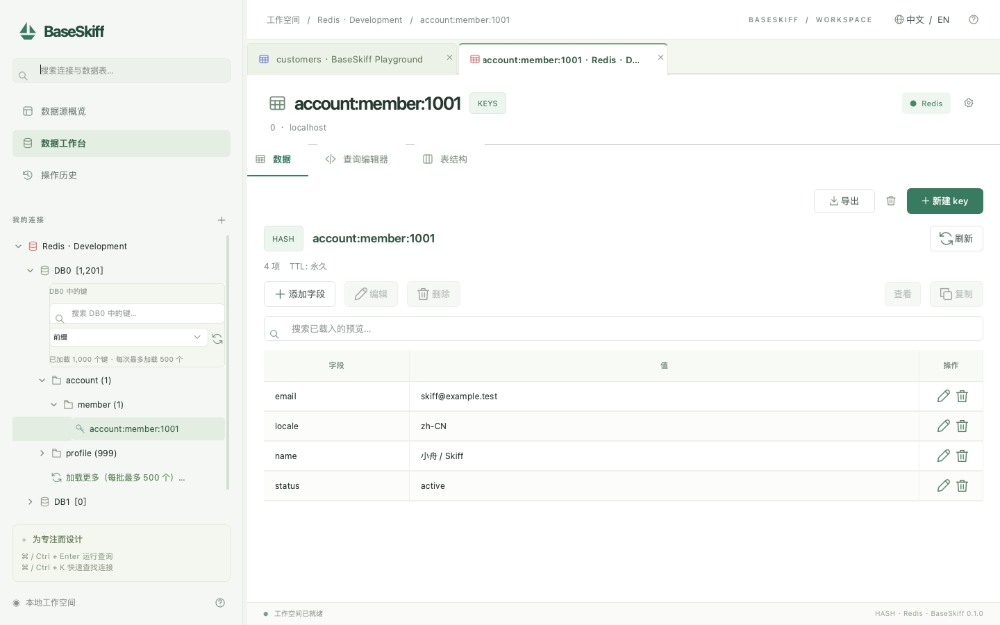
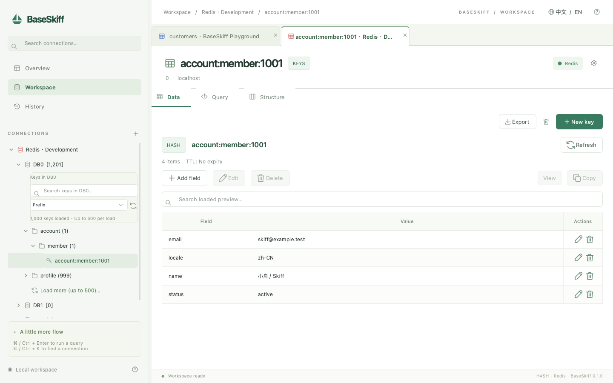
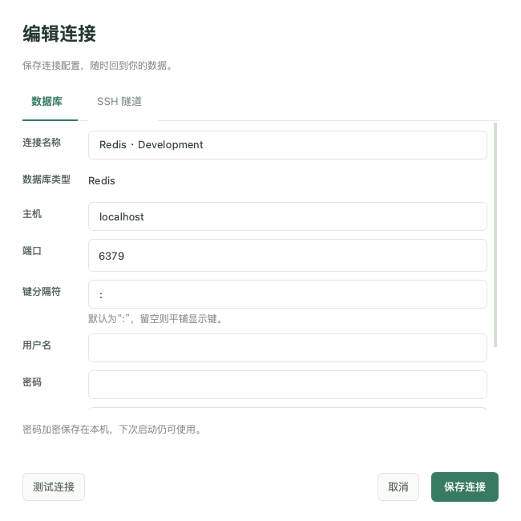

# Redis 浏览与键目录树

Redis 使用原生键搜索与分类型值视图，支持中文 / English 即时切换，直接连接与 SSH 隧道行为一致。

## 选择数据库

新建 Redis 连接默认使用 **DB0**。新建和编辑连接表单均不显示数据库索引，编辑已有连接会保留已选 DB。侧栏层级为「连接 → DB → 键目录 / 键」；展开连接只发现 DB 列表，展开具体 DB 才加载一批最多 500 个键，DB 下累计展示所有已加载的键。扫描未完成时再次展开 DB 或点击分支末尾「加载更多」继续下一批；完成后再展开只使用累计缓存。可读取服务端统计时，节点显示如 `DB0 [42]` 的键数量，空数据库也会列出。

切换会先验证目标 DB，成功后保存选择，重启应用后恢复。验证失败时仍停留在原数据库，保留原键列表与工作区。识别到 Redis Cluster 时只提供 DB0。

若 ACL 权限或服务端限制使 `CONFIG` 无法返回数据库数量，列表提供默认候选 DB0–DB15，并加入服务端报告或当前选中的其他 DB。「选择其他 DB… / Choose another DB…」允许输入其他编号，目标是否可用仍需通过服务端验证。无法读取服务端键统计时不显示计数；DB 节点的服务端键数与目录旁的已载入后代键数含义不同。

各连接的每个 DB 分别保留键搜索输入、模式与目录展开状态。不同 DB 的同名键独立处理，某个 DB 中的待完成修改不会锁定另一个 DB 的同名键。切换 DB 后，已排队的读取、写入和命令仍在发起时的 DB 执行，旧 DB 的迟到结果不会替换当前视图。

## 键搜索

展开 DB 后，在该 DB 分支首行的搜索区输入内容，只搜索此 DB，仅可选择「前缀 / Prefix」或「精确 / Exact」。搜索区随当前 DB 移动，折叠分支时隐藏；输入与模式按连接及 DB 分别保留。输入、清空内容或切换模式只更新草稿，不查询 Redis。点击输入框右侧的搜索按钮或按 Enter 才提交搜索；目录刷新继续使用上次提交的条件，保留未提交的草稿。草稿有变更时暂停「加载更多」，提交或恢复上次条件后可继续。侧栏最上方的搜索仍用于筛选导航树。

| 模式 | 匹配规则 | 示例 |
| --- | --- | --- |
| 前缀 | 字面前缀，`*`、`?`、`[]` 等字符不作为通配符 | `cache:` 查找以 `cache:` 开头的键 |
| 精确 | 完整字面键名，使用 `EXISTS` | `cache:*` 只查找名为 `cache:*` 的键 |

键搜索区分大小写，保留输入的空格，两种模式均将 `*`、`?`、`[]` 等字符按字面处理。前缀模式通过服务端 `SCAN MATCH` 扫描匹配键、去重，再批量执行 `TYPE` 获取类型并按分隔符建树，每批最多返回 **500 个匹配键**，保留游标并累计展示所有已加载结果，不限制为 500 个总数。每批最多执行 8 次 SCAN，稀疏搜索可能本批没有匹配键但仍需继续；「加载更多」保留到扫描结束。刷新或提交新的搜索条件会重新从头加载，续载失败保留已有结果，可再次重试。精确模式使用 `EXISTS` 直接检查完整键是否存在。

值视图中的「搜索已载入的预览 / Search loaded preview」只筛选当前预览内的字段、值、成员或分数：按字面子串匹配、不区分大小写，不向服务端查找其他条目。它与键树上方的搜索用途不同。

## 目录分组

新建或编辑 Redis 连接，在「数据库」页设置「键分隔符 / Key separator」。

| 设置 | 显示方式 |
| --- | --- |
| `:`（默认） | `h:match:event:1` 按 `h → match → event` 分组 |
| `::` | `cache::users::42` 按 `cache → users` 分组 |
| `/` | `cache/users/42` 按 `cache → users` 分组 |
| 留空 | 所有键平铺显示 |

分隔符按字面匹配，支持多个字符、Unicode 和空格。设置按连接独立保存；旧连接默认使用 `:`，无需重新创建。此设置仅在 Redis 连接表单中显示。

目录使用文件夹图标和括号计数；叶节点显示键名，可悬停查看。二进制键名与特殊字符使用安全的显示标记，显示过长时会截断；查询和修改仍使用完整原始字节。点击目录在本地展开或折叠，不重新扫描；点击叶节点才打开数据。键名不会被拆改或重命名。

同一层可以同时包含目录与键。例如 `cache` 和 `cache:users:42` 可以共存；连续、开头或末尾的分隔符也会保留，对应的空目录段显示为「空 / empty」。没有匹配分隔符的键直接显示在所属 DB 下。目录计数是**当前已加载的后代键数量**，不代表服务端完整键数，随当前搜索与已完成批次变化，不受 500 个总数限制。

搜索结果保留匹配键的父目录；清空内容并提交搜索后恢复原有展开状态。目录与键按 DB 分别识别，同名路径在不同 DB 中不会混用展开状态。刷新、重建列表和语言切换保留展开状态；主动打开其他键时展开其路径。连接根节点也有展开箭头，点击已载入且有子项的连接名称可收起整个键目录，当前工作区与查询内容保留。目录仅用于导航，不执行修改。点击 Key 打开新标签、切回已有标签和读取完成后均保留侧栏的横向与纵向滚动位置。

加载完成后，侧栏在空闲或滚动时不重复重建键目录。搜索模式菜单在选中、按 Esc 或点击外部关闭后，仍会完成等待中的目录更新；隐藏已经关闭的控件不会触发额外刷新。每批最多 500 个、累计展示所有已加载键的规则保持不变。

## 分类型值视图

选中键后可查看类型、大小 / 项数与 TTL，刷新、复制或打开只读值预览。Redis 驱动保留原始字节，仅将可无损解码的 UTF-8 转为文本，二进制字段、成员和返回值不会因 UTF-8 解码失败而丢失。普通文本按原样保存，数字和 JSON 文本不会自动转换。

| 类型 | 展示与操作 |
| --- | --- |
| String | 可无损编辑的原始文本支持保存；二进制或特殊文本只读；「查看」与「JSON 预览」打开通用预览窗口 |
| Hash | 字段 / 值列表，逐字段添加、编辑文本值、删除；选中行后可预览字段值 |
| List | 索引 / 值列表，编辑文本元素、追加、预览选中值；删除要求完整载入且不超过 1,000 项 |
| Set | 成员列表，添加、编辑文本成员、删除与预览选中成员 |
| ZSet | 成员 / 分数列表，添加成员、编辑分数、删除与预览成员；分数必须是有限数字 |
| Stream | 消息 ID 与字段结构，只读；选中消息后可预览结构或选择单个字段值 |
| RedisJSON | 用 `JSON.GET` 读取 JSON 模块值，只读预览 |
| 其他模块类型 | 用 `DUMP` 取得只读 Redis 序列化值，可预览或导出 |

集合最多预览 **1,000 项**。Hash / Set / ZSet 的逐项操作，以及 List 的按索引编辑与追加，在超过预览上限时仍可使用，不会替换整个集合。整键替换与 List 删除要求完整载入且不超过 1,000 项。

编辑数据时先选中行，再点击工具栏的编辑按钮；数据行双击没有特殊操作。

二进制内容以及 Qt 无法无损保存的特殊文本不进入原文编辑。特殊文本包括嵌入控制字符、孤立代理字符，以及会被文本编辑器规范化的回车、不可断空格和段落分隔符；普通换行和制表符仍可编辑。集合中的这类条目支持预览、导出和按既有规则删除，主窗口也支持删除整键。二进制 Hash 字段名和 ZSet 成员仍使用原始字节定位；编辑其文本值或分数不会改写标识字节。只读连接始终禁止删除和修改。

## 只读解码与原始导出

String 点击「查看 / View」，集合先选中一行再点击「查看 / View」。Hash / List 预览该行的值，Set / ZSet 预览成员；Stream 预览消息字段结构，可在窗口内选择单个字段值。String 的「JSON 预览 / JSON preview」也使用同一窗口。预览与原文编辑相互独立，切换格式不会将解码结果保存回 Redis。

| 格式 | 用途 |
| --- | --- |
| Auto | 先识别 JSON 和可打印 UTF-8 文本，再尝试完整的单个 MessagePack、BSON 或 CBOR 对象，以及完整的 gzip / zlib 压缩流；无法确定时显示 Hex |
| Text | 文本视图，无效 UTF-8 或控制字符以转义形式显示 |
| JSON | 只读格式化 JSON；无效数据或结构超限时显示提示并回退 Hex |
| MessagePack | 只读解码完整单对象；无效、尾随多对象或结构超限时提示并回退 Hex |
| BSON | 只读解码完整 BSON 文档，以 Extended JSON 保留 ObjectId、Decimal128、日期和二进制等类型 |
| CBOR | 只读解码完整 CBOR 对象，保留标签、二进制、重复键和非字符串键；结构超限时提示并回退 Hex |
| gzip / zlib | 解压完整的单一压缩流，再显示内部格式；尾随数据、校验错误或解压超限时回退 Hex |
| Hex | 十六进制原始字节 |
| Base64 | Base64 字节表示 |

常见 MessagePack map 显示为 JSON 对象；二进制、扩展类型、时间戳及特殊浮点数带明确类型标记，含非字符串键或重复键的 map 使用 entries 数组，避免显示转换时丢失内容。BSON 使用 Extended JSON 保留 BSON 类型；CBOR 的标签、二进制、非字符串键和重复键也会保留。Stream 等结构中的二进制字段带 Base64 标记。任意私有编码或需要专用 schema 的数据不保证能够识别，仍可用 Hex / Base64 检查字节。

解码和解压输入上限为 **1 MiB**，单次显示上限为 **200,000 个字符**，另有结构深度和条目数限制；超过上限会提示或回退，不会阻止原始字节导出。gzip / zlib 必须是完整的单一流，尾随数据、校验错误和解压炸弹会回退 Hex。在预览窗口点击「导出原始字节… / Export original bytes…」，保存的是该窗口持有的完整单值输入字节，文本使用 UTF-8，**不受预览截断影响**。集合结构本身不导出原始字节，应先选择独立的成员或字段值。复制取得的是当前显示文本，导出原始字节与 CSV 导出当前结果是不同操作。

RedisJSON 导出的输入来自 `JSON.GET` 响应。未知模块类型的 `DUMP` 结果包含 Redis 类型和校验信息，是序列化快照，不能视为业务原文；此回退不负责解析模块私有数据。JSON / MessagePack / BSON / CBOR 预览不提供格式转换保存，也不执行任意对象反序列化。键树每批最多加载 **500 个匹配键**并累计展示，集合值仍最多预览 **1,000 项**。

修改保留服务端绝对过期时间，避免保存时延长 TTL；乐观并发检查发现冲突后会要求刷新重试。只读连接禁用修改，操作会写入历史，直接连接与 SSH 隧道使用相同保护。

Redis 操作历史同时记录 DB 编号。双击历史记录会选择该记录的原数据库，再在查询编辑器中打开；表格操作记录仍以注释形式展示，供回顾使用。

各类型截图：[String](redis-type-string.png)、[List](redis-type-list.png)、[Set](redis-type-set.png)、[ZSet](redis-type-zset.png)、[Stream](redis-type-stream.png)。

## English: binary values and read-only previews

Navigation follows **connection → DB → key folders / keys**. Expanding a connection discovers DB metadata; expanding a DB loads up to 500 keys in one batch. Reopen it or click **Load more** to continue; every loaded key remains in the tree. A completed scan reopens from cache. Key search is the first row inside the active expanded DB and applies only to it. Each DB keeps its own search, mode and expansion state. Select a data row and click its edit button to edit it; double-clicking data rows has no special action.

Key search supports only **Prefix** and **Exact**, with input and mode kept separately for each connection and DB. Draft edits, clearing and mode changes do not query Redis: click the search button or press Enter to submit. Refresh keeps using the submitted filter and preserves the draft; Load more pauses while the draft differs. Opening keys retains the sidebar scroll position. Prefix matches a literal prefix through server `SCAN MATCH`; Exact checks the complete literal key with `EXISTS`. Both modes are case sensitive, preserve spaces and treat `*`, `?` and `[]` literally. Each prefix batch returns at most **500 matching keys**, and the tree accumulates all loaded results. A batch makes at most eight SCAN calls, so sparse searches can return an empty batch with more scanning available. Refresh or a new search resets the scan; failed continuation preserves loaded keys for retry. Search inside the loaded value preview remains a case-insensitive literal substring filter over loaded fields, values, members or scores.

Redis bulk strings are arbitrary bytes. The driver keeps those bytes and converts only losslessly decoded UTF-8 to text, including keys, fields, members, nested command replies and Stream fields. Tree and table labels safely mark binary or special content and may shorten long labels; operations still address the complete original identifier bytes.

Click **View** for a String, or select a collection row and click **View**. Hash and List rows preview their value; Set and ZSet rows preview their member. Stream rows open a field structure preview with a selector for an individual field value. The String **JSON preview** button opens the same read-only dialog. Choose **Auto / Text / JSON / MessagePack / BSON / CBOR / gzip / zlib / Hex / Base64**. Auto accepts complete single objects and tries JSON, printable UTF-8, MessagePack, BSON, CBOR, and complete gzip/zlib streams, then falls back to Hex. Compressed previews show the decompression and inner-format chain. Invalid manual JSON, MessagePack, BSON or CBOR shows a notice and Hex; Text escapes invalid UTF-8 and control characters. Switching formats never writes the decoded result back to Redis.

MessagePack maps with unique string keys appear as normal JSON objects. Binary values, extension types, timestamps and special floats carry explicit type markers. Maps with non-string or duplicate keys use entries arrays to keep all data. BSON uses canonical Extended JSON for BSON types; CBOR preserves tags, binary values, duplicate keys and non-string keys. Binary fields in structure previews use Base64 annotations. Private encodings and formats requiring a specific schema may remain undecodable; Hex and Base64 still expose their bytes.

Decoding and decompression accept at most **1 MiB**, display shows at most **200,000 characters**, and structure depth and item counts are bounded. Limits produce a notice or Hex fallback. gzip/zlib require one complete stream, so trailing data, checksum failures and decompression bombs fall back to Hex. **Export original bytes…** saves the dialog's complete scalar input bytes, using UTF-8 for text, without applying display truncation. Whole collection structures do not offer a raw-byte export; select an individual field or member first. Copying captures displayed text, and CSV export still covers only the displayed result or page.

RedisJSON uses read-only `JSON.GET`; its export contains that response. Unknown module types use read-only `DUMP`, whose bytes are Redis serialization with type and checksum information rather than the original application payload. This fallback does not interpret private module schemas. JSON, MessagePack, BSON and CBOR previews do not provide conversion-and-save or executable object deserialization.

Ordinary text CRUD preserves its contents without automatic number or JSON conversion. Binary content and text that Qt cannot preserve losslessly cannot be edited as raw text. This includes embedded controls, lone surrogates, carriage returns, nonbreaking spaces and paragraph separators; normal newlines and tabs remain editable. Such collection entries can still be previewed, exported and deleted under the existing rules, and the main window supports whole-key deletion. Editing a Hash text value or ZSet score preserves binary identifier bytes. Read-only connections continue to prohibit writes. The **500 keys per load** and **1,000 collection items per preview** limits, List deletion requirements, TTL preservation and conflict checks still apply.

## 验证范围

回归覆盖键搜索模式、字面特殊字符与空格、服务端匹配与去重、截断提示、连接间搜索状态、目录分组与展开状态，以及分类型预览、逐项修改、TTL、并发冲突、只读和历史。真实 Redis 与 Qt 操作覆盖直接连接及 SSH；兼容 Redis 5.0.14。最新测试数字与环境见 [验证记录](VERIFICATION.md)。
