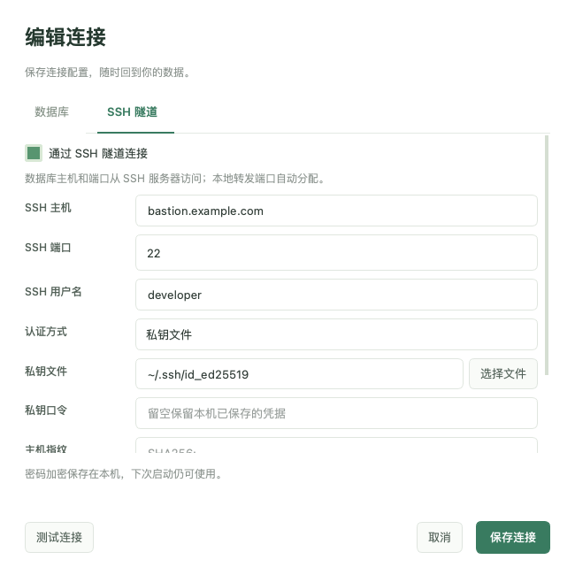

# SSH 隧道

## 配置

例如数据库位于堡垒机可访问的内部地址：

| 页面 | 字段 | 示例 |
| --- | --- | --- |
| 数据库 | 类型 | MySQL |
| 数据库 | 主机 / 端口 | `db.internal` / `3306` |
| 数据库 | 用户名 / 密码 | 数据库账号 |
| SSH 隧道 | 启用 | 勾选「通过 SSH 隧道连接」 |
| SSH 隧道 | 主机 / 端口 | `bastion.example.com` / `22` |
| SSH 隧道 | 用户名 | 堡垒机账号 |
| SSH 隧道 | 认证方式 | 密码、私钥文件或 SSH Agent |
| SSH 隧道 | 主机指纹 | 已核实的 `SHA256:…`，或使用 known_hosts |

SSH 账号与数据库账号分别填写。数据库主机由 SSH 服务器解析和访问；本机无需能直接访问 `db.internal`。若数据库就在 SSH 服务器上，数据库主机通常填写 `127.0.0.1`。SSH 服务端需要允许 TCP 转发。

私钥方式支持 RSA / Ed25519 和加密私钥。Agent 方式只使用当前进程可访问的 SSH Agent。文件选择器支持私钥和自定义 known_hosts。SSH 密码、私钥口令留空可保留已有连接保存的值。

未填写指纹时使用系统 / 默认或指定的 known_hosts；非默认端口遵循 OpenSSH 的 `[host]:port` 格式。首次连接未知主机会显示指纹并拒绝认证。通过可信渠道核实后，可把该指纹填入连接，或把对应公钥加入 known_hosts。填写指纹时固定使用该值，不能由 known_hosts 中的其他键替代。



## 行为与边界

连接测试、结构读取、列表浏览、命令和记录修改都通过 SSH，操作完成即关闭隧道。本地监听绑定回环地址并自动分配端口，不建立常驻的全局代理。SSH 连接启用 keepalive，连接与认证设有超时。

MySQL、PostgreSQL、Oracle、MongoDB、Redis 共用同一配置；SQLite 不启用 SSH。MongoDB 使用单目标连接，不做副本集发现或故障转移。隧道不改变只读限制、事务语义和操作历史。

可同时启用数据库 TLS。MySQL、Redis、MongoDB 的 TLS 路由保留数据库主机名，Oracle TCPS 保留原始连接描述；PostgreSQL 延用 `sslmode=require`，该模式只要求加密，不验证服务端证书身份。MongoDB 的 TLS 路由依赖经过兼容检查的 PyMongo 4.x 客户端池接口，依赖版本限制为 `<5`，不兼容时拒绝连接。

SSH 密码和私钥口令以加密凭据保存在本机应用数据目录，重启后仍可使用，不访问系统钥匙串。它们不会由凭据保存操作写入操作历史；编辑时留空保留本机已保存的值。应用不复制或保存私钥内容。

## 验证方式

`tests/test_ssh.py` 启动临时本机 SSH 服务，实际验证认证、公钥、加密私钥、SSH Agent、主机指纹、known_hosts、转发、目标限制、超时及清理。测试不修改系统 sshd、authorized_keys 或用户的 SSH Agent 配置。

`tests/test_ssh_adapters.py` 验证所有网络驱动的路由参数和关闭行为，并以真实的本机 TLS 握手验证 Redis / MongoDB 的 SNI 与主机名校验。

最新 Redis 分批加载及标签菜单版本的本地回归为 **751 项通过（35.41 秒）**，系统凭据导入尝试为 0。SSH 续载作用域在打开隧道前校验，并保留已有路由与关闭行为。由于 Docker API 仍无响应，本轮排除 101 项真实服务测试，未进行真实数据库 SSH 复验；以下为此前结果。

此前 `tests/integration/test_postgresql.py` 与 `tests/integration/test_oracle.py` 各通过 9 项真实服务测试，其中 SSH 用例通过临时回环 SSH 服务，分别转发至 PostgreSQL 18.6 / 5432 / `dev` 与 Oracle AI Database 26ai Free 23.26.3 / 1521 / `FREEPDB1`。验证认证、目录、CRUD、查询、只读和历史等操作，并核对 SSH 服务端收到的目标地址。两个套件另外覆盖直连数据类型、分页、事务保护及原生 Qt 多标签操作。

此前 `tests/integration/test_ssh_live.py` 已通过上述临时 SSH 服务连接实际本地 MySQL、MongoDB、Redis，验证认证、CRUD、查询、历史、只读以及 Qt 窗口中的连接测试、浏览和查询；同时检查 SSH 服务端收到的目标地址，防止绕过隧道直接连接。MongoDB 曾因 arm64 主机运行 amd64 镜像时的 QEMU / AVX 兼容问题未启动，当时 27017 未监听、健康检查为 `ECONNREFUSED`。用户修复环境后，MongoDB 8.3.8 认证 ping 成功且容器健康，**16 项 MongoDB 测试全部通过**，包括 9 项服务 / CRUD、3 项真实 Qt、2 项真实 SSH 和 2 项集合标签页。当时完整回归 **783 项通过（89.87 秒）**；后续 Redis DB 树阶段在最终标签保护前完整回归 813 项通过，该阶段最终本地回归 713 项通过。最终实机复验因 Docker API / MySQL 握手无响应而中断，当前不能保证服务仍健康；详细时间顺序和验证边界见 [实机测试报告](LIVE_TESTING.md)。

```sh
python -m pytest tests/test_ssh.py tests/test_ssh_adapters.py tests/test_ssh_dialog.py tests/test_ssh_service.py -q
BASESKIFF_LIVE_CONFIG=/absolute/private/local-services.json python -m pytest tests/integration/test_ssh_live.py -q
BASESKIFF_LIVE_CONFIG=/absolute/private/local-services.json python -m pytest tests/integration/test_postgresql.py tests/integration/test_oracle.py -q
```

私有配置格式见 [实机测试报告](LIVE_TESTING.md)。上述真实数据库连接使用明文 TCP 或 SSH 转发，未验证 PostgreSQL / Oracle 的数据库服务端 TLS；`sslmode=require` 仍不验证 PostgreSQL 证书身份。本次未使用外部堡垒机，也未在 Windows / Linux 上构建或运行产物。完整测试数量和打包结果见 [验证记录](VERIFICATION.md)。
