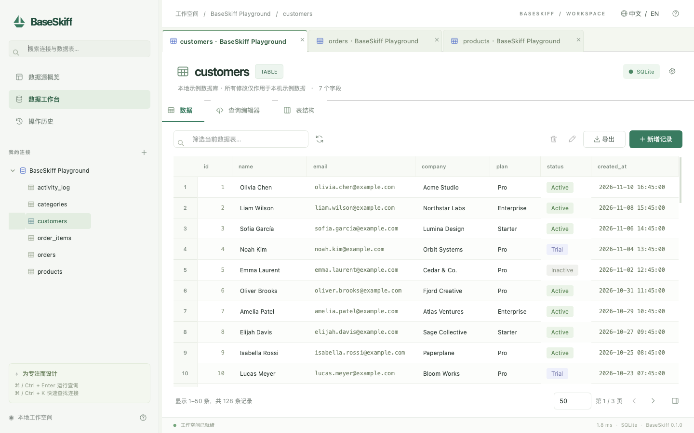
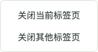
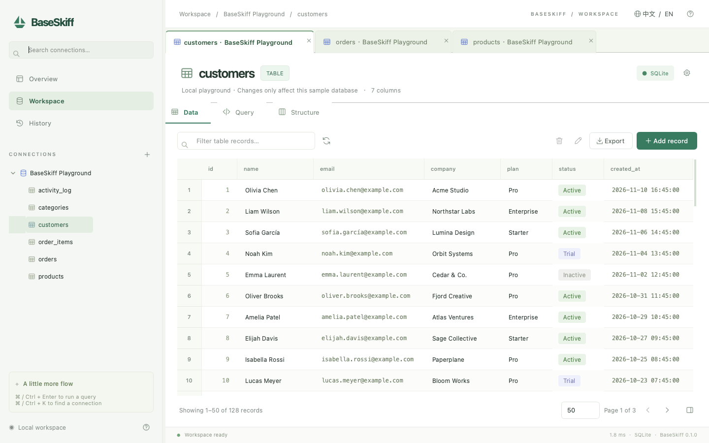
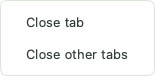

# 多表标签页 / Table tabs

## 打开与切换

在侧栏打开表、集合或 Redis 键，右侧工作区会新增并选中一个标签页，之前打开的对象仍保留。再次打开相同连接、数据库中的同一对象会切换到已有标签，不会重复创建。

例如先打开 `customers`，输入查询草稿，再打开 `orders` 查看数据；点击 `customers` 标签即可继续先前的查询。标签可以拖动调整顺序，打开较多时可通过标签栏的滚动控件查找其他标签。

外层标签选择正在查看的对象，标签内部仍可切换「数据 / 查询 / 结构」。标签名称及悬停提示提供连接和数据库来源，便于区分不同连接中的同名表。Redis 的 DB0 与 DB1 中即使存在同名键，也会使用独立标签；二进制键按完整原始字节识别，安全显示标记仅用于阅读。

## 各标签保留的内容

切换标签会保留各自的当前页、每页条数、筛选与排序、结构和已加载数据、查询草稿及光标位置、查询结果和状态，以及「数据 / 查询 / 结构」所在页签。数据行选择、滚动位置、列宽与记录详情面板状态也随标签保留。Redis 标签另外保留已加载值、原始文本草稿和预览内搜索内容。

后台读取、查询和修改仍属于发起操作的标签及其连接、数据库。切换到其他标签后，仍打开的来源标签保留其结果和错误；切回时可查看完成后的状态，查询错误显示在该标签的查询状态中。关闭标签后迟到的读取和查询回包会被忽略，不会重新打开该标签或覆盖其他标签的查询结果；已发出的写入仍在原连接与数据库执行。

## 关闭

点击标签的关闭按钮关闭该视图，不会删除对应数据库中的表、集合或键。关闭当前标签后会选中相邻标签；关闭最后一个标签后，右侧显示空工作区，可继续从侧栏打开对象。

右击任意标签可选择「关闭当前标签页」或「关闭其他标签页」，以右击的标签为目标。打开或取消菜单不会切换当前页面；关闭未激活的标签也会保留正在查看的页面和草稿。「关闭其他标签页」保留并选中该标签及其数据、查询草稿；只剩一个标签时此选项禁用。右击空白处不弹菜单。

## Open and switch

Open a table, collection or Redis key in the sidebar to add and select a tab in the right workspace. Previously opened objects stay available. Opening the same object in the same connection and database selects its existing tab without creating a duplicate.

For example, open `customers` and start a query draft, then open `orders` to inspect its data. Select the `customers` tab to continue the earlier query. Drag tabs to reorder them, or use the tab bar's scrolling controls when many are open.

The outer tab selects the object, and its inner **Data / Query / Structure** tabs remain available. Tab names and tooltips identify the connection and database. Redis keys with the same name in DB0 and DB1 use separate tabs. Binary keys retain their complete original byte identity; safe display markers only affect their labels.

## Retained state

Each tab keeps its page and page size, filters and sorting, schema and loaded data, query draft and cursor, query results and status, and selected **Data / Query / Structure** page. Row selection, scrolling, column widths and the record inspector state also stay with the tab. Redis tabs additionally keep their loaded value, raw text draft and search within the loaded preview.

Background reads, queries and writes remain attached to the tab, connection and database where they started. After switching away, the originating tab retains its results and errors while it remains open. Switch back to see its completed state; query errors appear in that tab's query status. Late read and query replies for a closed tab are ignored: they neither reopen it nor overwrite another tab's query results. Writes already submitted still execute in their original connection and database.

## Close

Use a tab's close button to close its view without deleting the database table, collection or key. Closing the active tab selects a neighboring tab. Closing the last tab leaves an empty workspace, where another object can be opened from the sidebar.

Right-click a tab for **Close tab** or **Close other tabs**. Both act on the clicked tab. Opening or cancelling the menu preserves the active page; closing an inactive tab also keeps the current page and draft. Closing others selects and retains that tab, its data and query draft. **Close other tabs** is disabled with only one tab; empty bar space shows no menu.

