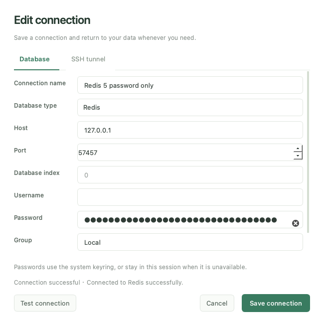

# Redis live integration results

Validated on 2026-11-11 against the user-supplied local **Redis 8.10.1** service, database **0**, using the real `DatabaseService`, `RedisAdapter`, and redis-py driver. No credentials, host address, or port are recorded here.

Result: **31 passed in 5.57 seconds**. Running the same module without `BASESKIFF_LIVE_CONFIG` produces **31 skipped**.

Coverage:

- Authentication, saved connection retrieval, connection testing, rejection of an incorrect password, and bounded key sidebar listing.
- Insert, browse, schema, update, and delete for strings, hashes, lists, sets, and sorted sets, independently checked through redis-py.
- Expiration preservation for edits of all five types; persistent keys remain persistent when their type changes.
- Invalid sorted-set scores, nested collection values, wrong JSON shapes, and empty collections reject replacement while preserving the original value and expiration.
- Hashes, lists, sets, and sorted sets containing 1,001 members return 1,000-member previews, mark truncation, disable schema editing, and reject attempted replacement without losing members.
- Unicode, spaces, quotes, and shell-like literal text survive grid and command round trips; search, missing keys, and key-record pagination behave as expected.
- Real commands read and write test keys, and a 1,001-item command reply is capped at 1,000 displayed rows.
- Read-only connections allow reads and reject command writes and every grid mutation operation.
- Success and error histories include the operation, connection, and elapsed time; clearing history works.
- Actual competing Redis writes immediately before `MULTI`/`RENAME` cause WATCH conflicts for insert and update, preserving the competing writer's value. The test controls timing through a client pipeline hook; the server operations and conflict are real.
- Empty, interactive, and blocking editor commands are rejected, and duplicate inserts, absent update targets, and invalid primary-key metadata preserve existing data.

The test suite uses random `baseskiff_it_<run>:redis:<case>:` prefixes, removes only those keys in fixture cleanup, and never uses `FLUSHDB`, grants, or server configuration changes. Database 0 had **0 keys before and after** this run. A final independent scan found **0 integration keys** and **0 application staging keys** remaining.

Run with a private JSON file containing `host` and `redis` fields (`port`, `username`, `password`):

```sh
BASESKIFF_LIVE_CONFIG=/absolute/path/private-live-config.json \
  .venv/bin/python -m pytest tests/integration/test_redis_live.py -q --tb=short
```

The sidebar intentionally scans at most 1,000 keys. When a reused database contains more keys, the tests verify the bound without assuming that a particular newly created key appears. This run used an initially empty database and did not stress a keyspace larger than the sidebar limit. TLS, Redis Cluster/Sentinel, custom ACL restrictions, binary values, and long-running concurrency were not exercised.

## Legacy authentication regression

A reported blank-username failure was reproduced against an actual isolated Redis **5.0.14** server: redis-py 8.1 defaults to RESP3 and sends `HELLO 3 AUTH default …`, which this server rejects. The adapter now explicitly selects RESP2 for direct and SSH routes. Blank usernames use password-only `AUTH`; named ACL users keep username/password authentication. Server errors that echo the connection password are redacted before display and history, preserving Redis exception types.

After the fix, all **31 integration cases passed in 4.60 seconds** against Redis 5.0.14 with the username empty. Native Qt connection testing, key browsing, query, CRUD and history also passed both directly and over a real temporary SSH server. The regular full suite passed **289 tests**, including the existing Redis 8.10.1 service cases, Redis tree navigation cases, and 10 new wire-level compatibility / error-redaction regressions.



The legacy server used a generated disposable password, an ephemeral loopback-only port and no persistent volume. Its test data and container were removed after verification. The reported external server was not accessed.
